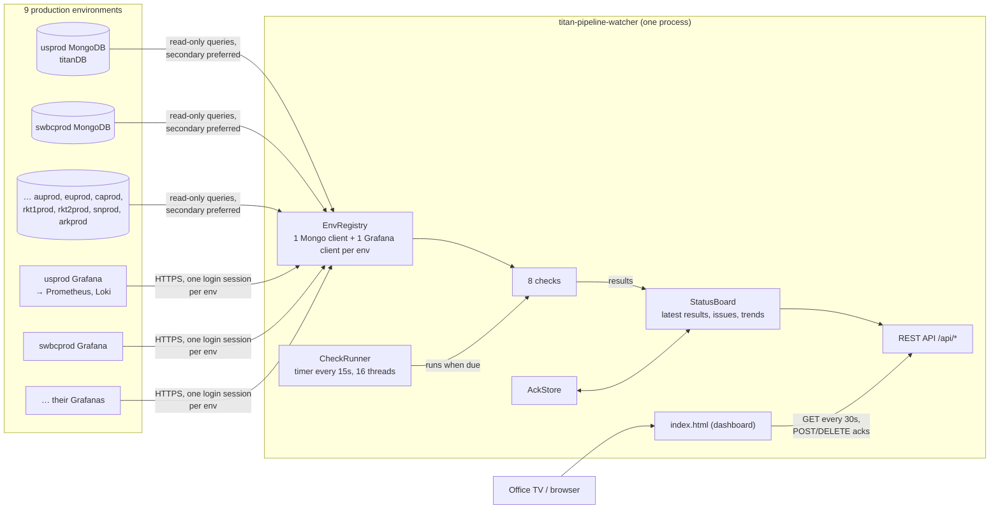
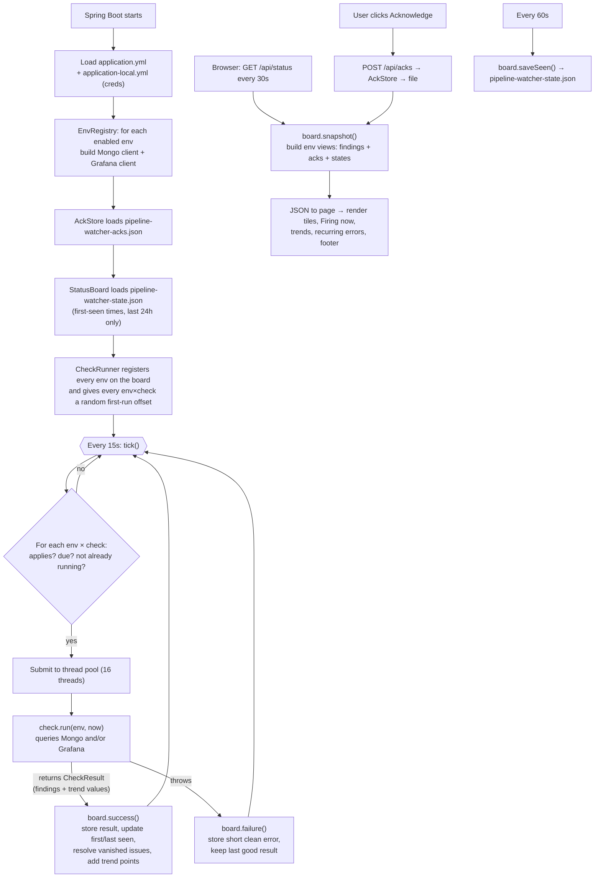
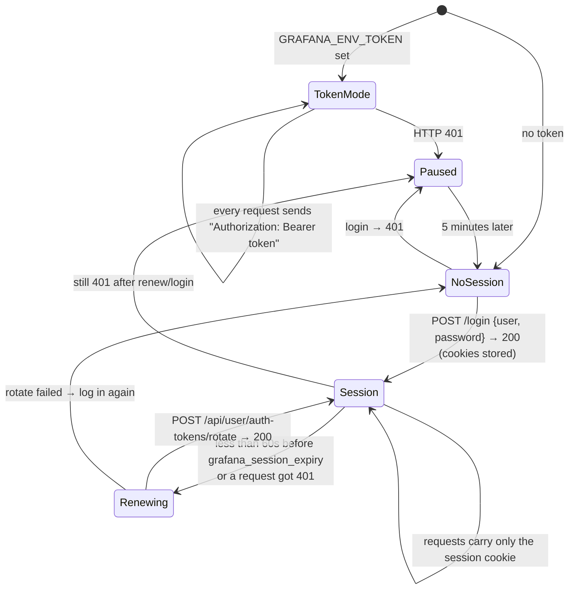
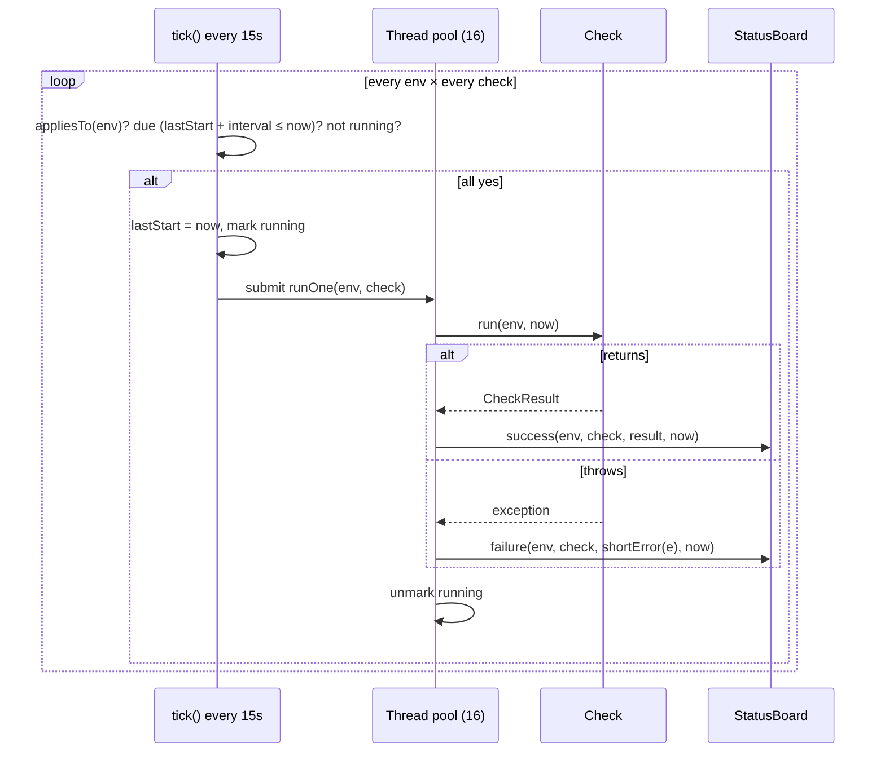
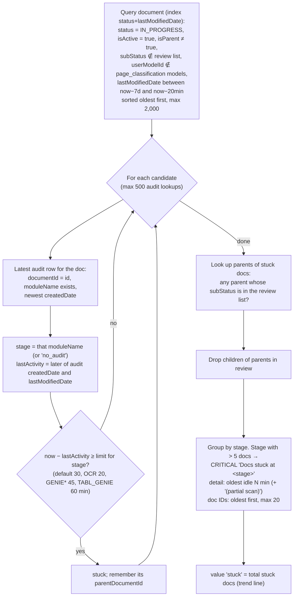
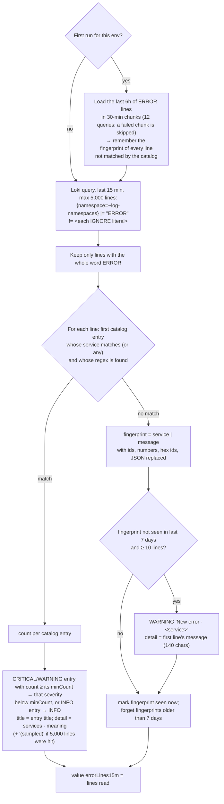

# Pipeline Watcher: diagrams

Flow diagrams for the service (kept here so `HOW-IT-WORKS.md` stays simple). They render on GitHub and in IntelliJ.

## The big picture

## Data flow inside the service

## Grafana login (session) states

## The scheduler (one tick)

## Stuck docs check

## Logs check

